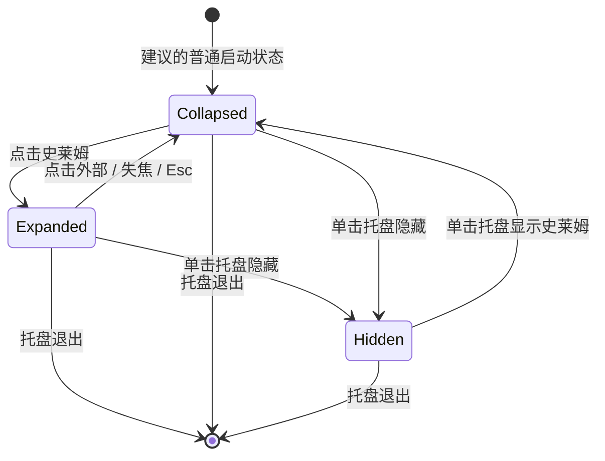

# Chat Bubble：需求与设计方案

版本：v0.14.0（GitHub便携更新）

日期：2026-10-27

阶段：核心功能已实现；公开版本的使用方式、验证边界及限制见README.md和docs/更新与发布.md。
适用范围：Windows 首版，单用户、单聊天入口、单一当前会话。

> 本文依据项目讨论整理。“已确认”表示已确定的产品要求；“建议”表示当时的默认方案；“后续”不计入该阶段验收。后续带版本号的规则取代对应早期方案。原型本身不证明真实聊天或桌面行为已实现。内部交接、验证备份及私人数据不上传公开仓库；公开版本的验证说明见更新与发布文档。截图能力见 §8。

## 1. 产品目标

Chat Bubble 是常驻桌面的轻量 AI 聊天入口。用户在使用其他软件时，可以唤起透明聊天窗口，直接输入、查看回复并连续追问，减少切换到完整应用的次数。

首要体验：随时唤起、原处回复、连续对话、聊完收起。

### 1.1 已确认的设计原则

- 聊天窗口悬浮在桌面上，背景透明，无可见外框。
- 消息正文直接浮在桌面上，没有消息气泡底色、边框和卡片。
- 用户消息块靠右，AI 消息块靠左，整体排列整齐。
- 不显示“你”“Chat Bubble”等消息身份标签，也不显示左上角产品标题。
- 输入框为较扁、较紧凑的胶囊形；发送按钮为黑色圆形、白色向上箭头，箭头比例协调并居中。
- 输入时不出现方形白色焦点边框。
- 不显示“Enter 发送”“Shift + Enter 换行”“演示回复”等常驻提示。
- 收起与隐藏是不同状态；二者都不清空当前会话。
- 2026-10-25 用户确认最后的史莱姆方案并要求正式接入：同体伸展输入框、点击外部缩回原位、松手后黏性贴边和少量表情；聊天能力继续复用现有实现。
- 2026-10-25 图标采用用户提供的黑色圆团、白色双眼史莱姆形象，透明背景，统一用于设置窗口、系统托盘、Windows 程序及启动快捷方式。2026-10-26 调整主体占比：按可见轮廓收紧原图透明留白，等比缩放并居中，常见 24px 档主体约 22px，保留透明边缘以避免裁切。
- 对话区隐藏纵向滚动条但保留上下滚动；消息与代码保持现有宽度约束，长行及连续长字符串自动换行，不出现横向滚动条。保留代码原有换行、缩进和文本内容，仅改变视觉折行。

### 1.2 如何判断首版完成

用户能够在真实 Windows 桌面上完成：

**唤起 → 输入 → 原窗口收到真实回复 → 连续追问 → 收起或隐藏 → 恢复原会话。**

只有静态页面、模拟回复，或者必须进入另一个应用查看答案，均不满足首版目标。

## 2. 范围与优先级

| 范围 | 内容 | 首版处理 |
| --- | --- | --- |
| 已确认核心 | 透明悬浮界面、胶囊输入框、无身份标签、紧凑排版 | 必须实现 |
| 已确认核心 | 展开、收起、隐藏、托盘唤起、保留当前对话 | 必须实现 |
| 为完成聊天闭环而建议 | 接入一种模型接口、逐步显示回复、失败反馈、基本设置 | 纳入首版 |
| 为完成聊天闭环而建议 | 当前会话本地保存、重启恢复、窗口位置保存 | 纳入首版 |
| 已确认核心 | 已确认的史莱姆形态、黏性贴边、同体输入框及表情 | 接入真实桌面与现有聊天，替换中性入口 |
| 后续可选 | 唤起时读取当前窗口画面 | 单独实现和验收，不阻塞首版 |
| 当前不做 | 多宠、多入口、多会话管理、云同步、账号体系 | 不纳入首版 |
| 当前不做 | 语音、文件上传、联网搜索、控制其他软件、自动执行任务 | 不纳入首版 |
| 当前不做 | 连续录屏、后台持续观察、无输入主动分析桌面 | 不纳入首版 |

这是一款聊天应用的首版，不需要先建设完整 Agent 工具系统。读屏也不等于获得操作电脑的权限。

## 3. 界面设计基线

### 3.1 当前参考图


以上为用户于 2026-10-24 提供并指定的参考图，界面外观以此图及已确认要求为准。此前带有左侧项目笔记、模拟桌面和底部托盘条的截图不再作为界面参考。

参考图保留为消息排版参考。最新桌宠方案覆盖其中右上角“收起”“隐藏”和旧入口：主聊天区仅显示消息正文、由史莱姆变形的胶囊输入框、截图及发送按钮，点击外部自动收回；没有产品标题、消息身份标签或输入框下方的快捷键说明。

图中对话内容是排版示例，不是成品固定文案；正文中的“这是模拟回复，还没有连接真实模型。”也不应作为成品的常驻提示。正式应用不绘制“桌面预览”“样式预览”、项目笔记或模拟任务栏。

**白色预览背景不意味着正式聊天窗口使用白色面板。** 正式窗口及消息区域仍保持透明，只有输入框有底色。

### 3.2 视觉规格

以下数值保留原型的布局参数作为实现起点，不是已经在原生窗口上验证的最终尺寸。用户参考图可能经过缩放，不能将图片物理像素直接当作应用尺寸；Windows 缩放比例变化时，以设备独立像素和参考图的实际观感为准。

| 元素 | 当前基线 |
| --- | --- |
| 聊天区域宽度 | 默认 248 px，与输入框同宽，设置可调 200—320 px |
| 消息区域高度 | 随内容变化，最大约 380 px，另受屏幕工作区限制；可滚动 |
| 消息正文字号 | 14 px，保留调整能力 |
| 正文行高 | 约 1.85 倍字号 |
| 消息间距 | 约 22 px |
| AI 文字 | 默认黑色，外观页可选自定义颜色 |
| 用户文字 | 与 AI 正文使用同一自定义字体颜色 |
| 文字投影 | 默认关闭，保留轻微投影的可选设置 |
| 输入框高度 | 固定 42 px，长文字与换行在内部滚动，不增高，不显示滚动条或拉伸角标 |
| 输入框外形 | 两端全圆的胶囊形，无厚重阴影 |
| 输入框底色 | 浅灰，参考 `#F5F5F5`；边缘仅保留细微轮廓 |
| 发送按钮 | 圆形直径约 28 px，随史莱姆颜色变化 |
| 发送图标 | 向上箭头约 14 px，按身体亮度配色，水平与垂直居中 |

补充规则：

1. “消息块靠右”不代表长段中文逐行右对齐。用户消息块整体靠右，块内仍按正常阅读方向左对齐；AI 消息块同理。
2. 长文字在限定宽度内自动换行；不通过缩小字体硬塞内容。
3. 显示文字与操作区域都应落在屏幕工作区内，不被任务栏裁切。
4. 箭头采用随应用打包的固定几何图标，避免不同字体把字符箭头渲染得过长或偏心。
5. 输入框去掉方形焦点轮廓，但保留正常光标、选中文本和输入法行为。
6. 深色壁纸上深色文字可能不够清晰，这是纯透明方案的实际取舍。外观页提供原生字体颜色选择器，自动保存并同时应用到用户和助手消息；旧配置缺少颜色时保持当前黑字，不再使用被固定黑字覆盖的浅色文字开关。不擅自恢复消息底色或进行持续读屏来判断背景颜色。

### 3.3 常驻可见元素

展开态只保留消息正文、胶囊输入框、截图图标和发送/停止按钮；截图图标紧邻发送键。原28px发送圆形和配色保持，向上箭头为22px。截图成功后图标显示待发送状态，再次点击弹出78×42px双图标胶囊浮层：左侧重新截图、右侧移除，无常驻文字，悬停及键盘聚焦提供名称。浮层须加入原生绘制及鼠标命中范围。无“收起”“隐藏”按钮，点击聊天区域以外或窗口失焦时自动缩回原位。

不增加标题栏、角色头像、身份名称、时间戳、欢迎卡片、模型说明和快捷键教学文字。错误或等待状态可以短暂出现，但不把开发信息作为产品内容显示。

模型配置、退出和其他低频设置放在托盘菜单中，避免堆进聊天主界面。

## 4. 窗口状态与系统托盘

### 4.1 三种可见状态

| 状态 | 桌面表现 | 程序是否运行 | 恢复方式 |
| --- | --- | --- | --- |
| 展开 | 消息和史莱姆变形的输入框可见 | 是 | 已展开 |
| 收起 | 聊天不可见，只保留史莱姆 | 是 | 点击史莱姆，回到同一会话 |
| 隐藏 | 聊天和收起入口都不可见，只保留真实系统托盘图标 | 是 | 点击托盘图标，只恢复史莱姆；点击史莱姆再展开同一会话 |

“退出”是独立操作：终止程序、移除托盘图标。不能把“隐藏”实现成退出，也不能把“收起”实现成系统最小化。



### 4.2 托盘与史莱姆菜单

- 托盘单击只切换桌面入口的显示/隐藏：隐藏时显示收起的史莱姆，可见时隐藏；不展开聊天、不激活输入框、不触发读屏。
- 托盘右键菜单按顺序保留“开始新对话”“设置”“退出”三项。“开始新对话”直接重置上下文，不弹确认、不主动展开；“设置”打开配置窗口；“退出”保存数据并结束程序。
- 史莱姆右键不弹出菜单：单击松开后跳跃躲避，按住右键拖动则原地拉伸，松手软弹恢复。开始新对话、设置和退出统一在托盘菜单操作，显示/隐藏由单击托盘切换。
- “开始新对话”点击后直接停止当前生成、保存并归档旧会话、创建空白上下文，不弹确认窗口；保持当前显示状态，不主动展开聊天。保存失败时保留原会话并提示错误。

“开始新对话”是必要的上下文重置入口；历史列表、查看与恢复放在设置页，聊天主界面保留单一当前会话。旧内容的保留策略见第 7 节。

### 4.3 窗口操作约定

- 最新确认：史莱姆、输入框及消息所在区域允许输入、选择、滚动和点击；其他透明区域应穿透到下方软件。实现采用透明桌面层配合原生鼠标忽略切换，绘制区域和鼠标命中分开；局部绘制范围仅在长距离拖出预留区域时扩展，并需保持指针捕获。松手不重设裁切，回弹稳定后再收小；不把整个绘制矩形当作交互范围。
- 2026-10-26：收起状态的原生窗口不激活，拖动史莱姆不抢占外部软件焦点；只有打开聊天框时才允许激活和输入。快速拖动即使未收到中间移动事件，也按松手位置识别为拖动，不误展开或读屏。
- 窗口模式由主进程统一决定。用户操作发送一次展开/收起请求，主进程通知仅更新界面，渲染器不能把通知再次发送成请求。重复的已应用模式不重复激活、广播或捕获。启动模式在加载页面前确定；桌宠初始化前收到的最新模式要保留，并覆盖迟到的旧场景快照，防止展开/收起反馈循环和连续截图。
- 实现取舍：桌面层使用显示器工作区联合坐标，位置和鼠标坐标采用 DIP；负坐标、显示器断开时恢复到有效工作区。当前实测单屏缩放，混合 DPI 和多屏仍需人工验收。
- 建议：普通桌面上保持置顶，避免一点击其他窗口就丢失聊天入口。
- 已确认：直接拖动史莱姆；正文可以选中，输入框和按钮不会触发拖动。
- 建议：保存最后位置，显示器断开或缩放变化后，把窗口移回可见工作区。
- 普通启动进入收起态，启动时不清空历史；只有点击史莱姆才展开聊天。新对话、恢复历史及重复启动均不作为展开入口。
- 重复启动只显示已有实例的史莱姆，避免多个托盘图标和重复请求。
- 第一版不承诺覆盖独占全屏游戏、系统安全桌面或所有管理员窗口。

## 5. 聊天行为与异常处理

### 5.1 文字输入

- 支持中文输入法、英文、标点、普通文本粘贴和多行文字。
- 建议键盘规则：Enter 发送，Shift + Enter 换行；支持这些操作但不常驻显示提示。
- 中文输入法还在选词时，Enter 不应误发送。
- 空字符串、只有空白的内容不发送。
- 收起或隐藏时保留未发送草稿；建议重启后也恢复草稿。
- 输入超过模型或应用支持范围时，保留草稿并给出明确反馈，不静默截断用户文字。

### 5.2 发消息到收回复

1. 用户发送文字，界面立即把它放到右侧，并显示简短的等待反馈。
2. 应用保存该消息的状态，组装当前会话上下文，向配置的模型发起一次请求。
3. 模型回复在左侧逐步显示；不能等用户切换到另一个软件才看到结果。
4. 回复完成后保存完整内容，恢复发送状态。
5. 用户连续追问时继续使用当前会话，不另开窗口或自动新建会话。

### 5.3 请求状态

请求状态与窗口状态分开管理：

| 请求状态 | 行为 |
| --- | --- |
| 空闲 | 可发送新消息 |
| 等待首段回复 | 有轻量等待反馈，避免用户以为按钮没反应 |
| 正在生成 | 左侧持续追加内容；同一会话不并发发送另一条请求 |
| 完成 | 保存完整回复，可继续追问 |
| 失败 | 保留用户文字和已收到的片段，明确失败，不伪装成完整回答 |
| 已取消 | 保留收到的片段，标记未完成，不继续追加 |

建议生成期间把原发送按钮切换为停止操作，不额外增加一排按钮；确切图标与交互在真实模型接入时确认。

收起、隐藏不等于取消生成。请求可以在后台完成，并保存结果；再次展开显示同一请求的进展或答案。第一版不额外主动弹出系统通知。

### 5.4 失败条件与处理

| 失败条件 | 必要反馈与恢复 |
| --- | --- |
| 未配置接口 | 提示前往设置，不发送请求 |
| 凭据错误或无权限 | 提示检查连接设置；不显示完整密钥 |
| 无网络、超时 | 保留输入，允许用户主动重试 |
| 额度不足、限流 | 提示服务返回的可理解原因，不无限重试 |
| 流式回复中断 | 保留已收到文字，标记回答未完成 |
| 服务不支持所选模型或协议 | 明确说明连接不兼容，不能当作聊天成功 |
| 本地保存失败 | 告知尚未保存，保留内存中内容，避免静默丢失 |

重试复用原用户消息，不重复插入同一句话；旧请求或过期响应不能覆盖新会话。建议等待首段回复和接收过程中无数据分别设置超时，具体值依据选定服务实测调整。

### 5.5 内容显示

- 不限制 AI 每句话为二三十字，不为了桌宠气泡而截断正常答案。
- 长回答可以滚动阅读；用户正在看历史时不强行拉到底部。
- 建议支持基础 Markdown：段落、列表、行内代码和代码块。代码块宽度受窗口约束，必要时在块内滚动。
- 正文可选择、复制；链接经校验后由默认浏览器打开。
- 不执行模型返回的 HTML、脚本或命令。
- 不在首版加入复杂公式、交互组件、附件预览和代码执行能力。

## 6. 模型接入与上下文

### 6.1 接入边界

2026-10-27（0.12.0）当前可选连接方式为 **API / 本地 Codex CLI**，按用户要求移除Claude CLI选项、自动发现和运行入口。兼容读取旧配置及旧归档，不删除历史文件；旧配置仍选Claude时先保留旧对话归档，再转为API待配置，不执行Claude。API 使用 Chat Completions 流式协议，由用户配置服务地址、模型名称和 API Key；“兼容接口”不承诺所有服务均无需适配。Codex CLI 自动查找本机安装，也允许手动选择原生可执行文件，复用 CLI 自身支持的登录方式，不要求在 ChatBubble 中填写 API Key。

Codex 通过官方 App Server 的 stdio JSON-RPC 接口调用。不读取浏览器会话、不复制登录令牌，不自动接管其他应用创建的聊天。Codex 使用 ChatBubble 自己创建的原生会话管理上下文，API由 ChatBubble 组装上下文。CLI 在本地运行不代表模型离线或免费，额度取决于 CLI 当前账户与登录方式。不因临时形象绑定模型厂商。

0.12.0会话来源边界：每段新对话保存不可随连接设置改变的source。按Codex CLI、DeepSeek API、Kimi API、智谱API隔离；自定义API按规范化服务地址分别隔离。已识别服务的官方等价地址合并，同一服务切换模型/强度不新开。改变来源时先用原设置归档完整当前消息、原生绑定和未发送草稿，再提交新连接及空白新会话；不携带旧消息、草稿或原生绑定。归档失败不得切换，最终保存失败恢复原连接和原会话，已生成的静态归档保留。

历史列表仅返回当前来源；预览、恢复、Codex原生跳转均在主进程重新校验来源，发送及失败重试也禁止使用不同来源或未分类上下文。恢复仅允许同源记录，仍先归档当前对话。切换后旧列表/预览的异步响应不得覆盖新页面，旧会话迟到的草稿/发送请求不得进入新会话。升级旧记录不按最后保存的连接猜测历史来源：仅所有消息均有有效原生轮次ID且保存为Codex连接的旧记录可只读识别为Codex；其他无来源记录保留原文件、计为未分类并在历史弹窗说明，可用打开文件夹访问，不参与同源恢复/续聊。当前旧对话未分类或与连接不符时，启动先保留归档再新开，不丢弃内容。此规则取代此前允许跨连接复用当前上下文的行为。厂商客户端原生历史同步及其他CLI接入仍不在当前范围；API图片能力见§8.1。

设置页提供连接方式选择。API 配置包括地址、模型与密钥；CLI 配置包括自动检测、手动路径、可选模型覆盖。连接检查使用已保存设置，不携带历史，并明确可能消耗额度或产生费用。CLI 检测只检查路径和版本，不自动安装、登录或发起模型请求。

设置初始内容宽 420px、行间距 18px，圆角 18px，跟随系统明暗主题；一行左侧名称、右侧控件。2026-10-27 最新确认：顶部采用“连接 / 聊天 / 外观 / 桌宠 / 版本”五个等宽选项卡，当前项以融入明暗主题的细下划线标识；点击直接切换内容，每次只显示当前分类，不再使用外观/桌宠折叠区，不增加大标题、说明段落或上下文选项。默认进入连接页，左右键、Home/End 可切换并同步焦点，提供 tablist/tab/tabpanel 语义。

窗口允许拖动边框缩放和最大化，原生最小宽度 360px、最小高度 240px。0.13.1修正（2026-10-27）：每次打开设置均恢复默认内容宽420px，包括关闭后重开或再次唤起仍已打开的设置；不记住本次运行中的旧大尺寸。切换选项卡时恢复默认宽度并重新按当前内容适配高度，退出原有最大化状态。仍允许手动拉伸/最大化，手调尺寸只在当前页保留；普通保存/内容更新不强制覆盖手调，切页或重开重新适配。高度按实际内容取整，至少240px内容高度、最多显示器工作区高度减80px；超长页面滚动显示。页面测量按动画帧合并，仅尺寸实际变化才调整，避免重复观察造成窗口抖动或增长。不新增持久化尺寸配置。窄窗口不产生横向溢出，内容超高时滚动，顶部选项卡保持可见。字号随窗口宽度在 13—20px 之间适度变化，控件高度、标签宽度、行距和内边距随之缩放；内容最大宽 72rem 并居中，避免最大化后输入框无限拉长。高度增大不将少量设置行强行分散到整个窗口。

连接页包含连接方式、程序路径、模型及适用的推理强度/API Key；API 以服务地址、模型和密钥替代 CLI 字段，自定义 Codex 模型按需显示输入。聊天页包含存储位置和历史对话；外观页包含字号、字体颜色、文字投影；桌宠页直接显示十项已有参数。各页继续即时自动保存，切换设置分类不清空输入、不覆盖待保存内容；改变连接来源则按上文归档并新开会话。自动保存结果和错误保留在共同页脚，“检查连接”按钮仅连接页显示。历史列表、预览、恢复及适用的客户端入口放在小弹窗内；存储位置只读显示，选择目录成功迁移后切换，双击路径可打开文件夹。

API 连接按“连接方式 → 服务商 → 服务地址 → API Key → 模型”排列。服务商仅预设 DeepSeek、Kimi、智谱 GLM，加自定义；不引入大型供应商列表或账号管理。选择不同服务地址时填入地址并清空旧模型，用户从下拉重新选择；仅手动清空同地址的有效模型仍拒绝覆盖。已有模型不在目录中时作为当前配置保留，不因刷新失败而丢失；选择“手动填写”可编辑原有模型字段。自定义地址仍可编辑，不强行替换用户原地址。

Key 保存后及打开已配置的 API 设置时，后台只读取模型元数据，不发送测试提示或历史。模型目录按保存的 Chat Completions 地址推导相邻 `/models`，DeepSeek/Kimi 尝试读取；智谱本轮未确认受支持的公开目录接口，直接提供官方少量常用候选。网络失败、无目录或凭据错误时仍保留候选和手填入口，候选明确不代表账户调用权限。Key 只从主进程的既有系统加密凭据库读取，并严格匹配当前保存的服务地址；不同地址/连接方式的目录请求拒绝，禁止携带 Key 跟随重定向。目录有超时和大小上限，错误不暴露服务返回正文或 Key。前端只接受当前服务、当前请求的结果，过期响应不能覆盖切换后的列表；刷新按钮可重试。模型显示名优先用目录返回的 name/display_name，实际保存和调用仍用 id；目录没有名称时保持厂商 API ID。内置候选用核对过的官方名称，DeepSeek 的 deepseek-flash 当前对应 DeepSeek-V4.1-Flash-1017，Pro 对应 DeepSeek-V4-Pro-0813，并非四个独立接口。目录有 released_at/created 时按日期倒序，无日期按官方名称/版本自然倒序（不能据此声称掌握实际发布时间）；最多显示前四项，旧的当前选择额外保留，不自动替换用户选择。打开连接页及点击刷新重新读取目录；智谱无已确认目录接口，保留需应用更新维护的官方候选，不宣称实时自动同步。Codex 保持原有 CLI 路线。

API 页提供独立的思考强度配置，默认不发送额外参数。已核对的 DeepSeek Flash/Pro 提供关闭、低、高、最高，关闭发送 thinking.type=disabled，其他档位发送 enabled 和 reasoning_effort。Kimi K3/K3.1 Pro/Highspeed 提供低、高、最高，只发送 reasoning_effort；GLM-5.3/Flash/FlashX 提供低、高、最高并发送 enabled。未确认能力的自定义服务/模型、GLM-4.7-Flash 暂仅提供模型默认，不伪造可调档位。API 配置与 CLI 强度独立保存；更换 API 地址或模型时恢复默认，非法档位后端拒绝。

0.9.0 移除“自动读屏”设置，截图统一由输入框中的图标主动触发；旧配置字段仅兼容保存，不触发捕获或限制手动截图。具体规则以 §8 为准。

0.11.0 在“聊天”设置中新增“截图范围”下拉：前台窗口/整个屏幕，切换自动保存。新用户及旧字段缺失时均保持原前台窗口模式；用户选择整个屏幕后才改用显示器捕获。切换不截图、不删除附件，但解除未发送的旧范围截图关联，迟到结果不能附回当前草稿。API仍不支持截图，选择范围不改变此限制。

2026-10-27 用户确认在现有设置基础上新增第五个“版本”选项卡，其他选项卡及行布局保持。版本页依次为当前版本、检查更新、软件更新；按钮使用文字内容宽度，不铺满整行。当前版本由主进程app.getVersion读取，不把原型的示例数字写死。0.14.0接通GitHub更新（2026-10-27，替代此前未配置来源状态）：来源固定为SeXon007/ChatBubble的GitHub Releases，用户点击才检查最新正式版本。检查无正式发布、失败、已最新、发现新版分别展示，不发送模型请求、聊天或凭据，也不嵌入GitHub Token。发现新版后下载固定命名Windows x64 ZIP，核对GitHub资产SHA-256和大小，显示进度，在旧版同级独立目录准备新包；不覆盖已有版本或chat。准备完成后按钮变为重启并更新，保存成功且无正在生成的回复才正常退出，由助手等待退出后启动新版；保存失败取消重启，启动失败尝试恢复原快捷方式并启动旧版。只接受GitHub HTTPS及已知资产重定向主机；解压拒绝路径越界、符号链接、重复路径及用户数据。普通打开页面不联网，不自动检查。详见docs/更新与发布.md。版本页状态不被其他设置保存/回送覆盖，切回原有分类后继续显示其保存状态。读取版本失败明确提示并保留原有设置可用。UI新增交付独立0.10.0便携包，保留0.9.0和聊天目录。

2026-10-27 版本规则更新为“主版本.功能版本.修复版本”：Bug 修复递增末位（0.11.0 → 0.11.1），UI 调整或新增小功能递增中间位且末位归零（0.11.2 → 0.12.0）；重大更新递增首位，按用户约定保留功能版本且末位归零（0.11.2 → 1.11.0），不因功能版本达到某个数字自动升级为 1.x。各版本交付独立包，保留旧包及已有聊天目录，不为版本升级迁移或覆盖用户聊天数据。

取消手动保存键。下拉框与开关立即提交，文本暂停约 350ms 或失焦后提交；中文输入法合成期间不提前保存。修改按顺序更新同一份 state.json 配置，前端按字段版本保留后续编辑，避免旧状态回送覆盖正在输入的值。后端只校验和更新所改字段，未配置好连接也可修改字号；无效字段及写入失败不能覆盖旧有效配置，提示保留在窗口底部。关闭设置或正常退出应用前处理最后一次输入；若仍有失败的修改，仅在此时提示继续编辑或放弃。临时原子写入、有效备份、聊天位置索引及系统加密密钥存储继续保留，不另建第二套生效设置。

API 密钥结束编辑后独立加密保存，不在普通配置或状态回送中出现；每次提交携带对应服务地址，地址已改变时拒绝旧密钥提交。更换地址可自动保存，但旧地址密钥不会发送给新地址。检查连接先处理当前有效修改，有错误时不请求模型。目录搬迁仍需选空目录、复制校验成功后再切换，不随文字输入逐字迁移。

Codex 历史目标已接入 0.5.0：参考 Claudian 的原生持久会话路线，用 thread/start 创建、thread/resume 续接；在 ChatBubble 状态中保存原生 ID、数据环境及最后一轮对应关系，每次只发送新问题，新聊天使用新 ID。原生历史由 Codex 自己写入同一本地 CODEX_HOME，默认用户目录 .codex；ChatBubble 本地记录目录只保存界面快照及设置，迁移它不迁移 Codex 原生历史。旧版记录不自动导入（用户已说明无需迁移）。本机两轮真实测试通过进程重启续聊、上下文记忆和原生重读，桌面端会话列表及读取接口均已找到同一个 ID；设置历史区提供“在 Codex 中查看当前对话”。直接点击系统链接尚未人工验收。来源/项目筛选及跨环境可能影响其他安装，不承诺跨电脑、WSL 或不同 CODEX_HOME 自动同步。

会话 ID 必须保存成功后才发送模型请求。停止先尝试 turn/interrupt，失败只终止自己启动的进程。重试仅允许回退自己最近的失败/中断轮；若上一轮实际上已完成，则读回原生结果，不重复请求。原生消息 ID 未必等于 clientUserMessageId，因此用保存的 turn ID 与本地用户消息关联确认所有权。已有已提交会话不能因恢复失败静默换成空会话；只有确认不存在、尚无提交标识的空会话可以重新创建。桌面端新增消息导致历史超出已知位置时拒绝回退/继续追加，提示开始新对话，避免覆盖；不提供完整双向编辑或标题同步。连接检查仍用临时会话，不加入原生历史。不直接改 Codex 内部数据库或全局配置。

设置控件显示当前模型和推理强度，不再额外重复“已保存模型”横幅。Codex 选项来自本机模型缓存，不读取令牌、不发起模型请求；来源及缓存窗口在悬停信息中说明，允许手填其他名称。推理强度通过 turn/start 的 effort 显式传入；已保存但缓存不再声明的档位保留显示并注明待确认，不能悄悄显示成默认。CLI 默认的悬停信息明确实际型号未确认，不把缓存首项或模型自述当作生效型号。API 保留模型手填入口，不发送 Codex 专用强度参数。

CLI 限制为聊天：使用独立工作目录，通过 stdin 传递消息，禁止 shell 字符串拼接。Codex 沿用用户登录与连接配置，以启动覆盖施加只读权限、关闭命令/插件/浏览器/记忆等能力；创建会话前按只读配置结果逐个禁用 MCP 并复核，MCP 名称不兼容时拒绝连接。清除继承的父会话与宿主工具环境字段，防止误关联开发会话。无效协议、工具事件或客户端工具请求会停止本次回复；不暴露原始诊断或凭据。版本缺少必要参数或接口时应拒绝运行。取消只停止该次进程树，不终止用户其他 CLI。Codex 使用真实文本增量，不伪造流式效果。

API 聊天历史由 ChatBubble 本地保存和续聊。2026-10-27 修正 CLI 历史入口：选择 Codex CLI 时，历史弹窗始终保留 Codex 查看按钮；未选归档时对应当前对话，选中归档后对应所选对话。仅当连接已保存为 Codex CLI 且对应记录有原生会话绑定时可点击；没有绑定时禁用并解释原因，不隐藏入口，也不将 API 本地记录伪装为 Codex 会话。主进程从当前状态或经校验的本地归档读取原生 ID，通过既有 codex://threads/ 链接打开。查看归档不恢复或替换当前对话，不停止当前生成，不修改归档；打开当前对话继续先停止并保存。保留的旧 Codex ID 不能使 API 模式显示该按钮，主进程也必须拒绝 API 模式的 Codex 打开请求。DeepSeek API 提供“打开 DeepSeek Harness”，Kimi API 提供“打开 Kimi”，智谱 API 提供“打开 ZCode”。这些入口只打开客户端，不导入或定位当前对话，弹窗明确提示“此 API 对话保存在 ChatBubble，暂不支持在对应客户端中查看”。本项目的直接 Chat Completions 请求没有创建对应客户端的原生会话，不能仅凭已安装客户端将打开应用称为查看当前对话。自定义地址未识别服务商时只显示本地保存说明，不猜测客户端。

客户端按已保存的官方 API 地址匹配，在打开历史弹窗及点击入口时检查用户/公共桌面和开始菜单的已知快捷方式；只接受存在的对应命名 EXE，忽略快捷方式附加参数，不执行快捷方式或 Shell 脚本，不复制 Key 或会话文件。没有检测到时提示“未检测到可用的 X 客户端。请先安装，或检查桌面、开始菜单中的快捷方式。”这是检测结果，不能断言用户从未安装。检测后服务已切换时拒绝启动；迟到的检测结果不能覆盖新服务。客户端检测和启动均仅允许设置页调用。

### 6.2 一次请求的数据流

```text
用户输入
  → 保存消息与请求编号
  → 读取当前会话中可用的历史
  → API 组装历史；Codex 续接原生会话并只发送本次问题
  → 模型接口
  → 接收回复片段
  → 左侧逐步显示
  → 保存完整结果或失败/取消状态
```

“界面能翻到的历史”与“本次发送给模型的上下文”分开处理：本地可以保留较长记录，但每次请求必须遵守模型长度限制。

2026-10-25 最新目标：不提供上下文选择或设置行，自动使用所选 CLI/服务支持的 token 窗口，不另设较小的应用档位，也不把“最大”解释为每次填满请求。0.5.0 起 Codex 已沿用原生会话管理和压缩，不再使用旧字符筛选及 12,000 字符输入限制；保留 200,000 字符的本地输入保护，不将它作为模型 token 窗口。容量、压缩阈值、已用量分别处理，系统说明及输出空间也由 Codex 管理；尚未执行 500k token 满窗口压力测试或显示实时用量。缓存不作运行确认，不以字符比例猜精确 token。0.6.0 设置对所有连接均移除预算选项；API 后端暂保留旧预算以兼容现有数据，不把未知服务宣称为已支持最大窗口。

失败、等待中的占位内容不作为有效助手答案发送，截断或取消不标记为完整答案。API 后续请求排除不完整助手片段；Codex 由原生会话保留真实轮次状态，重试先安全回退本应用最后一轮，不重复拼接整段本地历史。

### 6.3 能力认知

首版 AI 只能理解用户文字与实际传入的上下文。未启用截图功能时，不能声称“我看到了你当前的界面”。模型输出具有不确定性，连接成功或单次回答正确都不代表能力已经稳定。

## 7. 本地保存与恢复

### 7.1 保存内容

| 数据 | 建议保存方式 |
| --- | --- |
| 当前会话标识、消息正文、时间和状态 | 本地会话文件 |
| 未发送草稿、字号、文字颜色、投影、窗口位置 | 本地配置 |
| 模型地址与名称 | 本地配置 |
| API Key | 操作系统保护的凭据存储，不写入普通配置或网页存储 |
| 截图与附件 | 成功保存的截图直接放在聊天目录下 `attachments/`，供请求绑定、重试及原生历史引用；未发送图片也保留，不自动删除，由用户手动清理。不再使用 `screenshot/` 临时目录 |

首版建议先用小型、按会话保存的 JSON 文件与原子写入，避免为单一会话引入数据库依赖；达到历史检索、多会话和迁移等真实需求时，再评估 SQLite。

原子写入的含义：先写临时文件，再替换正式文件，减少崩溃导致整份历史损坏的风险。建议保留最近一个有效备份。写盘进行串行协调，不让旧版本内容覆盖新消息。

### 7.2 恢复规则

- 收起、隐藏后立即恢复原会话，不从磁盘重建一段新对话。
- 应用正常退出或重新启动后恢复最近会话和草稿。
- 启动时把遗留的“正在生成”消息标为“已中断”，不永久显示转圈，也不自动重发计费请求。
- 数据损坏时优先读取备份，原损坏文件留存供恢复，不悄悄用空历史覆盖。
- “开始新对话”新建会话标识并停止使用旧上下文，旧文件不自动删除；设置页提供归档列表、正文预览和确认恢复。恢复前先归档当前会话，只恢复聊天内容与草稿，保留当前连接设置，不自动请求模型；恢复后的当前会话使用新的标识。
- 密钥无法解密或安全存储不可用时，要求重新输入或仅在本次运行内使用，不退化为明文落盘。

0.8.0 新用户默认在程序文件夹内固定 `chat/` 保存应用聊天记录；已有自定义位置优先保留，旧默认位置安全复制并核对后切换，原件保留。首次保存后持久记录位置，升级到其他版本目录仍使用已有聊天目录。升级须保留 `chat/`，不覆盖用户资料。

设置页显示当前聊天目录和历史归档目录，提供打开文件夹及更改聊天存储目录。切换时要求目标为空文件夹，串行保存当前状态，复制并逐文件核对当前对话、设置及全部归档，写入目录位置配置成功后才切换；保留原目录作为静态备份，不删除、不继续同步。失败继续使用原目录，部分复制文件保留供核对。位置配置和系统加密密钥留在 `%APPDATA%\ChatBubble`，CLI 工作目录也留在应用数据目录。重启时若自定义目录不可用或缺少会话文件，应停止启动并保留数据，不能静默创建空历史。

## 8. 手动读取当前画面

### 8.1 定义与范围

0.13.0 API 图片规则（2026-10-27）：复用同一手动截图键、两种范围、持久附件及发送/重截/移除流程。Codex CLI继续支持；官方API只对已核对的视觉模型启用：DeepSeek的deepseek-flash及兼容旧名deepseek-v4-flash-vision-exp；Kimi的kimi-k3.1-pro、高速版、kimi-k3、kimi-k2.6及kimi-k2.7-code/高速版；智谱的glm-4.6v、glm-4.6v-flash、glm-4.6v-flashx。其他官方模型禁用截图并提示选择已知视觉型号，不自动切换模型。自定义兼容Chat Completions的API可尝试image_url输入，界面悬停说明实际能力由服务端决定；未配置服务或模型时禁用。智谱候选增加GLM-4.6V-Flash，账户权限仍以服务端为准。

API发送时从当前聊天目录attachments读取对应PNG，图片内容直接随请求发送到所选API，不上传公共图床、不发送本地文件路径。DeepSeek/Kimi/自定义发送data:image/png;base64 URL，智谱按官方示例发送裸Base64。请求前检查附件目录、文件、PNG签名、符号链接及大小；迁移后按附件文件名读取复制后的资产，不读取元数据中的任意路径。单图上限16,000,000字节，按最新优先最多8图、总原始图片上限24,000,000字节；文字仍使用原字符预算，不把它当作精确token预算。当前图无法读取或超限时本轮失败，不静默删图发送文字；服务拒绝图片时给出识图模型/协议提示，不自动改模型或重发。用户可重新截图后作为新消息发送，失败重试始终使用原用户消息已保存的图。

成功轮次中仍在文字上下文范围内的历史图可随追问重发，增加图片输入用量；它们明确标注历史时间语义，不代表当前画面。旧图缺失、超预算或切换文字模型时以明确未附图标记替代，不阻断纯文字续聊；失败轮次不进入成功历史。重启保留已发送图供重试与续聊，但不恢复未发送关联。更换服务、模型、截图范围或会话时清除未发送关联，迟到截图不能重新附入；更改外观不清除。所有文件继续保留，不自动删除。以上API规则替代下述旧版仅Codex截图的限制，CLI工具权限及厂商原生历史同步范围不变。

2026-10-27 确认0.9.0交互：取消展开时自动截图，改为用户点击输入框截图图标才捕获一次。打开、收起、拖动、长按松开及普通文字发送都不自动截图；旧“自动读屏”配置不再影响行为。Codex CLI及符合§8.1的API视觉模型支持图像发送，截图键在不支持的连接下禁用并提供说明。外部前台窗口身份由后台助手记录，但窗口画面只在明确点击截图键时捕获。

2026-10-27 追加0.11.0范围选择：前台窗口模式保留最近外部窗口的单窗口画面；整个屏幕模式读取鼠标所在显示器的完整可见画面，包含桌面、多个窗口及其实际遮挡关系、屏幕边缘和任务栏，也可能包含可见的ChatBubble界面。多屏只取选定的一个显示器，不拼接全部显示器。两种模式均只在点击时读取一帧；后台只跟踪窗口/显示器身份，不持续采集画面。保留既有最长边1920px等比缩小及图片大小限制，缩小不裁掉屏幕区域。

按钮区沿用现有桌宠同体展开的精确胶囊轮廓，固定42px高；只增加紧邻发送键的截图图标。捕获期间按钮标为忙、禁止重复点击及发送；失败显示“未能读取画面”，清空待发送关联，不拿上一次图片冒充成功。成功仅更新图标的待发送状态，不弹成功窗口。再次点击该图标可重新截图或移除，浮层只显示两个图标。Esc优先关闭浮层，再按Esc收起聊天。

发送前、发送时及发送后，ChatBubble 的输入区和消息记录均不显示截图、图片附件卡片或图片占位；图片作为真实 localImage 输入进入 Codex 原生消息。应用渲染与原生记录分开处理，不用文字路径代替图像输入。已验证模型识图、原生重读及桌面读取接口保留图片引用，实际桌面图片展示仍需人工确认。

“读屏”在这里指：按选择截取一次窗口或显示器画面并交给视觉模型理解。它不代表能读取软件内的全部文档、滚动区域外内容，也不代表模型具备点击、输入或操作电脑的能力。

每次手动请求冻结当前截图范围及对应窗口/显示器身份，捕获过程串行协调，只保留最新有效请求的关联；没有固定冷却或自动复用。收起/隐藏保留当前草稿的待发送截图，不自动重新读取；重启不恢复未发送图片关联。发送后只消费本条的关联，重试仍使用原请求的图片。移除、重截失败、新对话、修改截图范围和切换到不支持图片的连接会解除待发送关联，迟到任务不能附到新会话或新范围。

### 8.2 流程

```text
点击桌宠 → 立即展开聊天，不截图
点击截图图标
  → 按设置固定最近外部窗口或鼠标所在显示器
  → 后台读取一帧并保存到 attachments
  → 图标显示有待发送画面，可重截或移除
  → 用户发送问题时，连同这张截图一起发送给视觉模型
  → 清除本次待发送关联，图片文件继续保留
```

抓取画面与发给模型分开：打开聊天不捕获，点击截图只保存一帧，发送问题后才请求模型。

应用不主动添加闪屏、快门声、成功弹窗、图片缩略图或常驻读取状态，不为截图延迟展开聊天。Windows 捕获后端可能带有系统捕获标识，需在实际使用的 Electron/Windows 环境验证；尚未承诺所有设备均无系统边框或其他可见变化。

前台识别保留既有修正：忽略焦点切换瞬间的空HWND；同一窗口可读状态恢复后重新公布有效目标。显示器身份独立跟踪，在桌面或ChatBubble获得焦点时仍可整屏捕获。助手尚未就绪时等待初始观测；就绪后冻结手动请求时的目标，不在排队过程中改抓其他窗口或显示器。单次捕获超时2.5秒（不含助手初次启动），无旧图复用。历史图片只能用于回顾，不能作为当前屏幕的证据。

捕获底层沿用Windows.Graphics.Capture，窗口使用CreateForWindow，整屏使用CreateForMonitor：复制一帧到CPU后关闭捕获会话，再编码PNG；不调用PrintWindow或要求目标重绘，不因失败改抓另一范围。系统可能显示短暂捕获边框。单窗口和纯色背景/多个重叠窗口的整屏合成场景可分别验证；真实直播/游戏帧率及全部应用兼容性仍需人工确认。

聊天数据目录内部统一为 `state.json`（含原子保存的备份）、`sessions/` 与 `attachments/`；所有截图及附件直接保存在 `attachments/`，不再创建 `screenshot/`。新版本使用独立发布包并更新快捷方式，已有聊天目录位置及历史图片路径保留。图片目录跟随聊天存储根目录；已有用户自定义目录优先保留。迁移复制附件并保留原件，不清理Codex仍引用的旧路径。凭据和位置配置继续留在 `%APPDATA%\\ChatBubble`。

实测Codex原生历史保留localImage文件路径，因此截图首次保存即使用持久`attachments/`路径，发送时直接绑定该文件，不复制第二份。未发送、移除、重截、收起、隐藏、重启和退出均不自动删除已保存图片；“移除此图”仅移除本次待发送关联。开始捕获后即使关联失效，返回图片仍保存，不能错误绑定新请求。尚未执行的过期排队任务跳过捕获。删除被历史引用的文件后，回看原图或重试可能找不到文件。

旧 `screenshot/` 中的普通文件按原名复制到 `attachments/`，逐文件核对内容后移除旧条目；重名时换用唯一文件名，绝不覆盖已有附件。迁空后仅移除空的旧目录，自建子目录、链接及其他非普通文件保留，不递归删除。此操作是旧目录迁移，不是自动丢弃图片。原生会话本身仍由 Codex 数据目录保存，移动 chat 不等于跨电脑迁移全部原生会话。

### 8.3 关键边界

- 只读用户所选范围对应的窗口或显示器，前台窗口失败不回退整屏，整屏失败不改抓其他窗口/显示器。
- 鼠标点击桌宠/托盘可能已经改变前台焦点，因此需要记录最近一个外部前台窗口；不能仅在窗口显示后再查询前台程序。
- 前台窗口模式在目标已关闭、已最小化、处于受保护内容或无法可靠识别时明确显示未读取；整屏模式在显示器不可用时明确失败，受保护窗口可能在系统合成帧中为空白；均不拿旧截图冒充新画面。
- 不能保证捕获所有应用；黑屏、缩放、HDR、多屏和窗口权限需要单独测试。
- 当前会话不能因唤起而重置。待发送截图只绑定下一次用户发送；重试使用对应请求的同一截图。解除绑定不删除文件，已发送图片可继续通过同一原生会话的上下文参与后续问答。
- 重截及移除为独立图标入口，只有点击才执行。截图失败不能伪装成功或使用旧图，在既有状态区域给出简短说明。
- 云端视觉模型需要接收截图。启用时明确接收方和传输范围；本地模型方案也需要验证硬件资源及模型能力。
- 截图、网页和软件中的文字作为待分析数据，不能当成用户授权去执行操作。
- 普通文字聊天在截屏失败或模型不支持图片时仍可使用，不声称完成了图像理解。

首版不建设 OCR 回退链、持续监控、自动滚动截长图或后台录屏。是否选择视觉模型或本地文字识别，应在确定需求后再做取舍。

## 9. 技术设计建议

### 9.1 推荐起点

建议采用 **Electron + TypeScript + HTML/CSS**，先面向 Windows。

Electron 可以把网页界面装进桌面程序，承接真实窗口、托盘和桌面系统能力。当前界面已用 HTML/CSS 验证，沿用它可以降低重新还原样式的成本。代价是安装包和运行内存通常高于更轻的原生方案；正式选型前仍要做一个透明窗口与托盘的小型验证。

备选方案是 Python + PySide6，适合希望把主要工程学习放在 Python 的情形，但需要重新实现当前网页布局。2026-10-24 在用户要求开始构建后，本批采用 Electron + TypeScript 验证路线，避免同时维护两套界面；原生表现仍需按验收清单核对。

第一版界面规模较小，建议先不引入前端框架、独立 Web 服务或额外 Python 后端。用少量本地组件和明确的数据流完成闭环，后续出现复杂界面再判断是否需要框架。

### 9.2 模块职责

```text
界面层
  消息正文、输入、滚动、窗口操作
      ↕ 受限的进程间接口
桌面主进程
  窗口/托盘 ─ 聊天请求协调 ─ 模型调用
                   │
              本地会话与配置
                   │
              操作系统凭据保护

后续扩展：收起入口的素材播放器、单次窗口截图服务
```

建议职责划分：

| 模块 | 负责什么 | 不负责什么 |
| --- | --- | --- |
| 界面 | 显示与收集操作 | 保存密钥、直接访问任意文件、执行模型输出 |
| 窗口控制 | 展开/收起/隐藏、位置和焦点 | 拼装提示词 |
| 聊天协调 | 请求编号、状态、取消、过期响应、上下文预算 | 绘制窗口 |
| 模型接入 | 连接、请求、流式事件、错误标准化 | 决定用户何时截图 |
| 存储 | 配置、会话、原子写入、恢复 | 擅自把数据上传云端 |
| 凭据 | 系统保护的密钥保存与读取 | 把密钥返回给界面用于显示 |
| 后续桌宠外观 | 播放素材、接收点击、触发展开 | 持有聊天记录或调用模型 |
| 截图与附件 | 识别目标、单次捕获、持久保存与请求绑定 | 自动执行屏幕上的指令 |

进程间接口指界面向桌面主进程发出的受限请求。只暴露诸如“发送消息”“收起窗口”等明确操作，不把整个操作系统 API 暴露给界面。

### 9.3 最小数据契约

实现时至少需要以下概念，不要求按下面字段名原样编码：

- 会话：标识、创建时间、最后更新时间、消息列表、草稿。
- 消息：标识、角色、正文、状态、所属请求编号、时间。
- 请求：标识、所属会话、用户消息标识、状态、取消标记、错误类型。
- 窗口：展开/收起/隐藏、最近有效位置、显示器信息。
- 模型配置：服务地址、模型名称、协议、凭据引用；不在消息对象中保存密钥。
- 截图与附件：标识、来源窗口、捕获时间、保存路径、绑定的请求；图片内容不进入普通日志。

模型事件建议统一为“开始、片段、完成、失败、取消”，均带请求标识。界面丢弃不属于当前有效请求的迟到事件。

### 9.4 基本安全与可靠性

- 只加载随应用打包的界面与图标，不依赖 CDN 才能显示发送按钮或桌宠。
- 界面进程关闭 Node.js 直接访问，启用上下文隔离与沙箱；进程间请求校验来源和参数。
- 模型回复经安全渲染，远程网页不直接替换应用主界面。
- 密钥只在需要发请求时使用，不进入渲染层、会话文件或日志。
- 日志只记录请求状态、耗时和经过脱敏的错误；默认不记录正文、截图和凭据。
- 不因收起或隐藏停止保存结果；隐藏时停止无必要的动画和界面刷新。
- 不默认开机自启、不自动更新安装，也不自行把该应用接入现有 Codex 聊天。

## 10. 桌宠素材与交互原型

### 已确认的桌宠方案（2026-10-25）

用户已确认最后的内嵌方案，并明确要求修改正式应用。0.7.0 以此方案替换旧中性入口和独立展开窗口；保留真实聊天、草稿、停止/重试及 Codex 原生会话。下述原型记录是设计来源，实际生产验证以 progress.md 与原生证据为准。自定义形象和导入仍暂缓。

参考 [Kimi 官方桌宠介绍](https://www.kimi.com/resources/what-is-a-desktop-pet) 的史莱姆形态贴边和气泡聊天。用户要求覆盖官方的悬停行为：**拖到边缘附近，鼠标松开即吸附；按住时不自动吸附，无停留秒数、加载进度圈或额外范围图示。** 软团自行绘制，不复制原厂动画文件。原型使用网页区域，正式版使用真实显示器工作区边缘，不放入任务栏。

**吸附表现为朝向边缘的重力瘫软。** 每个边缘都是地面，重力方向朝向该边缘；靠边按住时仍保持完整球形，不提前变形。松手立即启动，先落到承托面、轻微接触/预压，再逐渐受压降低厚度、沿地面向两侧摊开，重心移向地面。整团始终留在可见区域，不将圆心移入墙内，不裁掉身体制造压扁效果；可见面积应大致保留。接触响应先起，身体形变略滞后，但均为连续松弛，不能分段等待、瞬间吸附或硬切轮廓。整体保持圆润，无细颈或独立“接触手”；晃动余速被消散，不越过位置目标。尚未接触地面时不提前瘫软，四个方向遵循相同规律，不转身或翻面。

**最终是完整瘫在地面上的软团。** 圆球逐渐变为平底、拱顶的软团；用户最新截图要求贴边后向外更饱满，避免过扁。当前原型沿地面长度由原球直径的 145% 收至 118%，法向总厚度由 65% 增至 85%，厚度与接触长度之比约 0.72；终态可见面积约为原球的 100%，不采用截掉身体的方案。接触面最长，靠近角落时为完整轮廓留足位置。临近稳定时仅保留非常轻微且逐渐衰减的回弹，不持续大幅抖动。眼睛基准尺寸独立于身体形变，随完整身体移动；表情仅调整眼形，视线受轮廓限制，保证双眼完整可见。数值为当前原型探索值，仍需体验评审。

轻拉回贴，明显拉开恢复自由形态且不立即回吸；吸附未完成时可再次抓住，从当前显示位置接续拖动。可调“贴边黏稠感”改变连续松弛速度，不引入悬停、松手等待、分段停顿或阶段进度。

**四边均保持正面，不做翻面或转身。** 左/右/上/下仅改变挤压与贴合的方向，保持轮廓顶点对应与绕向一致；眼睛也始终保持左右顺序。眼睛跟随要夸张、灵动，尤其允许白色眼睛明显向上移动，带柔软追随并限制在身体内。视线只跟随史莱姆附近（中心半径约为当前屏幕长边的一半，即半屏左右）的鼠标；超出该范围后平滑回到中位并停止唤醒，不整屏追逐鼠标。去除“点一下试试”等桌宠悬停文字，保留干净外观。

**身体与眼睛尺寸分开。** 正式版采用用户最终选择：身体 82%、眼睛大小 140%。眼睛 100% 基准为每只约 5.8×14.6 px（睁眼时），中心间距约 18.1 px，整体上移约 5.2 px。独立“眼睛大小”滑块范围 70%—140%，同步缩放普通、拖动、眯眼和休息眼形，不改变身体、两眼中心间距、上移位置或发送按钮。调节身体大小也不缩放眼睛。大小选择持久保存，已有正式版数据新增桌宠字段时使用本节确认值。移动范围按实际眼形和身体轮廓限制，涵盖较小身体、放大眼睛和夸张视线。

**先探索少量状态表情。** 保持双眼的简洁形象：待机偶尔柔和眨眼；拖动时眼睛更圆、更大；接触贴边时短暂眯眼，稳定后恢复；静置约 10 秒开始困倦、约 12 秒闭眼休息，视线轻轻回中。在跟随范围内移动鼠标、触碰或点击即唤醒；鼠标远离到范围外时不再唤醒，视线回中并进入待机/休息流程，休息时仍可一次点击展开聊天。表情权重连续过渡，不改变已确认的身体轮廓和吸附运动。减少动态效果时不自动眨眼。原型中的“表情预览”仅作设计参考，不新增正式运行设置。

2026-10-26 最新调整：在上述基线上保留三种轻微眼睛动作，以协调和克制为准，不修改身体轮廓、吸附、鼠标跟随范围或已有困倦/眯眼：

- 拖动受力：跨过原有拖动阈值后短暂轻挤眼、衰减回弹；移动中速度倾斜限约 4°，回弹幅度约 3°，视线惯性限约 1.5px；比首次版本明显收敛。单纯按住/点击不触发这段动作。
- 好奇张望：必须先有跟随范围内的真实鼠标移动，之后静置约 22 秒才可能触发一次，约 3.8 秒内轻看一侧、再看另一侧、回中并继续眯眼。视线幅度约 6px，睁眼和倾斜比首次版本收敛。左看时左眼略短、右眼略长；右看时右眼略短、左眼略长，左右起始方向交替。至少冷却 90 秒；超过 35 秒仍未触发的旧活动资格失效，鼠标持续静止不会自行周期重复。新鼠标移动、抓取或打开聊天优先打断，自主张望不重置活动时间。
- 松手回神：真实拖动松手且位置/速度已稳定后，轻快眨两下再恢复；贴边时等吸附基本稳定，取消拖动或单击不触发。新操作可打断。

三种动作复用现有动画帧和内存状态，不新增定时器、声音、设置或持久化字段；聊天展开/隐藏及“减少动态效果”会抑制新动作。旋转与两眼轻微不对称的外包范围纳入现有眼睛轮廓约束，小身体/大眼睛和四边都不能让双眼出界。

2026-10-26 右键互动已确认采用成品源码预览的“跳跃躲避”和“原地拉伸”，不采用挤眼回应或轻碰回弹，不新增菜单、模式选择或桌宠设置：

- 右键单击：松开时确认未跨过 5px 拖动阈值，触发一次蓄力→弧线跳开→落地回弹；沿用已确认的 126px 候选距离、46px 弧线高度与 0.24 软弹参数。方向在四周候选中随机选择，不按靠近屏幕中心加权；四个边界仅约束落点和整段身体轮廓，可用空间不足时缩短位移、排除过短候选。靠左/右时也能明显沿边向上、向下跳，顶部/底部同理；不保证相邻两次方向一定不同。结束后保存新位置。
- 右键拖动：跨过同一阈值后原地拉伸，方向和程度跟随鼠标，输入长度软限幅，原弹簧手感滞后追随；主体落点和贴边状态不改变。贴边时整个接触面固定，形变从接触面向内平滑增强；边界不足时等比例收住整团形变，不逐点截断轮廓，避免斜切边或尖角。松手后衰减回弹，过程中不触发跳跃。快速松手即使没有中间移动事件也按最终位置判定；拖出去再拉回原点仍算拖动。
- 指针取消、捕获丢失、窗口失焦均不触发跳跃；隐藏、展开、位置恢复或设置更新会结束当前互动。松手立即退出捕获，不依赖下一帧。互动不激活聊天、不请求截图或模型；左键点击只展开聊天，截图由独立按钮触发。
- 为减少原生区域更新对桌面合成的影响，绘制区域与鼠标命中区域分开：鼠标穿透始终使用当前实际内容；跳跃及右键拉伸用固定局部绘制包围框。左键拖动时使用覆盖身体及弹簧目标的局部包围框，仅在长距离拖出预留范围时扩展；单击、拖动与松手均不切回不受限整屏窗口。左键松手保留原局部绘制框到回弹稳定，再收小，松手瞬间只释放捕获和更新命中区域，不重设原生裁切。视频/游戏真实帧率仍需在目标环境验收。
- Windows桌宠主窗口使用工具窗口类型，避免Chromium遮挡检测按桌面大小外框将底下网页误判为完全遮挡；收起时不激活，展开后仍可输入，手动截图不要求暂停目标视频。
- 复用原动画循环、身体轮廓与眼睛逻辑；没有独立的夸张挤眼动作，跳跃保留已确认的轻微起跳眼睛反应。“减少动态效果”时不自动跳跃，手动拉伸直接随输入变化，松手直接恢复。

**史莱姆与输入框是一体的。** 单击后以连续形变拉长为胶囊输入框，两只眼睛向右端合拢并过渡为发送键。完全展开后上下边缘水平平直、两端半圆衔接，不保留身体鼓包；变形过程中连续过渡到此轮廓。展开时不在旁边保留独立宠物；回复无底色，位于输入框正上方，与输入框共用宽度及位置。

**自动缩回，无“收起/隐藏”按钮。** 打开时记录史莱姆当下位置，点击聊天/输入框以外的位置，或窗口失焦后，沿反向动效变回史莱姆并返回该位置。输入、点击发送、选择/滚动回复不误关；不设闲置秒数。草稿和记录保留，点击外部关闭时不重新抢焦点。Esc 作为键盘替代保留。显示器变化时恢复到有效工作区。正式版回复接到既有真实服务和流式聊天逻辑，收起不停止生成。

正式版使用最终选值：身体 82%、眼睛 140%、基准视线幅度 24 px、灵动 1.2、贴边范围 52 px、伸展框 248×42 px、纯黑 `#000000`、黏稠感 1、自由弹性“黏糯”。视线再乘身体比例并受轮廓限制，不是 Kimi 官方参数。生产设置在“桌宠”选项卡内直接调整这十项参数，自动保存到原有 state.json；原型的临时表情预览不作为生产运行设置。颜色影响身体和发送键，并按亮度配眼睛/发送符号颜色。减少动态效果时直接贴合。自定义形象和文件导入暂缓，不提供停留时间。

### 后续素材接入

后续可以自行制作形象，也可以采用授权允许的第三方素材。

聊天与桌宠外观分开后，更换一套素材只应影响收起入口及动画，不应迁移聊天记录或重写模型调用。不过，换“素材包”和接入“整个开源桌宠应用”难度不同：后者还涉及窗口、事件、配置和依赖的适配。

建议先定义一个很小的素材约定：待机动画、可选的忙碌/回应动画、显示尺寸与点击区域。GIF、透明视频或其他格式只选择实际需要且打包后可可靠播放的格式，不预先支持所有格式。

当前大肥鱼动图仅为临时演示，用户未认可为最终形象，也未确认再分发许可。正式成品打包前单独核对代码、图片、动画各自的授权和署名要求；不因为仓库标注开源就默认所有素材都可商用或再许可。桌宠未确定时，首版使用中性占位入口。

## 11. 验收清单

### 11.1 视觉与窗口

- [ ] 真实桌面可透过聊天窗口看到，消息没有底色、外框、角色头像或身份标签。
- [ ] 无左上角产品标题，无常驻快捷键说明、演示字样、模拟桌面背景和模拟任务栏。
- [ ] 胶囊输入框单行紧凑，圆形按钮黑底白箭头，图标居中且不过长。
- [ ] 点击输入框无方形白色焦点框；文字选择与中文输入正常。
- [ ] 长段用户消息块整体靠右，块内正常阅读；AI 消息靠左。
- [ ] 在 Windows 100%、125%、150% 缩放下无裁切，切换显示器后窗口可找回。
- [ ] 只有实际窗口矩形范围参与交互，范围外能正常操作其他软件。

### 11.2 聊天与上下文

- [ ] 能向真实模型发送文字并在原窗口收到回复，明确区分模拟演示与真实请求。
- [ ] 中文选词回车不误发送，空白输入不发出请求。
- [ ] 先发送一个约定信息，再追问它，验证同一会话上下文确实携带。
- [ ] 较长回复没有被硬截成短句；流式中断不会显示为完整成功。
- [ ] 请求生成中不重复发送；用户主动重试不重复插入原消息。
- [ ] 用户阅读历史时，新片段不会强制抢走阅读位置。
- [ ] API 断网、密钥错误、限流和超时均能恢复，不丢输入、不无限重试。

### 11.3 收起、隐藏与恢复

- [ ] 收起后只显示史莱姆；再次点击同体展开，恢复原会话和草稿；点击外部缩回原位。
- [ ] 隐藏后桌面没有聊天窗口或收起入口，实际系统托盘图标仍存在。
- [ ] 点击托盘直接展开并聚焦输入框，不另起会话。
- [ ] 生成途中收起或隐藏，结果仍保存，恢复后可查看。
- [ ] 退出与隐藏行为不同，重复启动不会生成多个实例。
- [ ] 重启后恢复最近会话；遗留请求显示已中断，不自动重复调用模型。

### 11.4 数据与安全

- [ ] 普通配置、会话文件与日志中没有 API Key；不能因凭据存储失败而明文保存。
- [ ] 恶意 HTML/脚本作为普通模型内容不会执行。
- [ ] 写入中断或数据损坏时，能够读取备份，不覆盖用户原数据。
- [ ] 无论旧读屏配置是什么，展开、收起、隐藏、长按/拖动松开及文字发送都不自动截图；只有明确点击截图/重截图标才请求捕获。

### 11.5 读屏与 API 图片的独立验收

- [ ] 只有明确点击截图/重截图标才读取一帧，不随展开或文字发送自动捕获，不持续采集。
- [ ] 前台窗口模式抓取最近使用的外部窗口；整个屏幕模式包括选定显示器的完整可见范围及多个重叠窗口，不裁成单个窗口，也不拼接所有显示器。
- [ ] 仅唤起不自动请求云端模型；发送问题后才附带明确的截图。
- [ ] 能辨识并显示截图失败，不能以旧图替代成功状态。
- [ ] 输入框固定42px高，截图键紧邻发送；长文字内部滚动，无内边框/可见滚动条/拉伸角标。截图管理为双图标浮层，无常驻文字，悬停/聚焦有说明，原生绘制及鼠标命中包含浮层。
- [ ] ChatBubble 在发送前、发送时及发送后的消息记录均不显示截图或附件占位；同一原生消息在 Codex 桌面端可显示图片，文件保留与重启后的原图展示单独验收。
- [ ] 捕获期间禁止重复点击和发送；重截失败不复用旧图，移除只解绑不删文件，发送消费一次，收起/展开保留草稿关联；新会话/不支持图片的连接/重启不误用旧关联。
- [ ] 设置不再显示自动读屏开关，旧字段只作文件兼容；截图键按连接及模型能力启用，已确认的 API 视觉模型可截图，未确认的官方模型禁用并说明，自定义兼容 API 可尝试。正常文字发送不显示虚假的捕获失败提示。
- [ ] API 请求包含截图实际 PNG 字节，DeepSeek/Kimi/自定义使用 data URL，智谱使用官方裸 Base64；请求不包含本地附件路径。重试不重新截图，重启后仍可读取原图；历史图标注为历史，缺失/超预算时明确标记，不冒充当前画面。
- [ ] 聊天设置可选择截图范围并自动保存/重启恢复，旧设置缺失时保留前台窗口；切换解除旧图关联但不截图、不删除附件。
- [ ] 快速拖动未收到 pointermove、普通拖动、拖回原位及取消拖动都不展开、不截图；收起状态下拖动不激活 ChatBubble。Windows原生绘制区域保持局部包围框，不切到不受限整屏；拖动中仅在超出预留范围时扩展，需验证指针捕获持续有效。松手立即结束捕获并提交准确鼠标命中区域，绘制包围框保持到回弹稳定后再收小，松手瞬间不重设原生裁切；动画暂停也不滞留整屏区域。单纯长按松开可按点击展开，但不截图；实际游戏/视频帧率须独立验收。
- [ ] 截图直接写入聊天目录的`attachments/`，发送、移除、重截、收起、重启与退出均不自动删除；旧`screenshot/`校验迁空后移除，不覆盖已有附件，不改变聊天数据目录位置或既有消息路径。
- [ ] 用固定样例核对文字、表格和软件界面的识图效果，明确验证过的范围。

## 12. 开发批次与交付物

| 批次 | 目标 | 可以检查的交付物 |
| --- | --- | --- |
| A：桌面骨架 | 验证透明局部窗口、托盘、三态切换和输入法 | 可运行的 Windows 开发版本；此时允许模拟回复 |
| B：真实聊天 | 一种模型接口、上下文、逐步回复与异常恢复 | 可完成真实连续对话的版本与连接说明 |
| C：保存与稳定性 | 会话/草稿恢复、原子保存、位置/DPI、单实例与凭据保护 | 通过首版验收清单的候选版本 |
| D：打包验收 | 在非开发目录启动并确认资源完整 | 安装包或便携包、运行说明、已知限制 |
| 后续独立批次 | 选定桌宠形象或单次读屏，分别验证 | 不混入首版聊天闭环的大批重构 |

按依赖关系推进，不把“批次完成”等同于“所有功能完成”。模型与网络操作离开界面线程，避免等待回复时窗口无法输入或隐藏。

## 13. 开发前需要最终确定的事项

以下问题不影响本次方案整理，但会影响实际接入或分发：

1. **技术路线**：本批已采用 Electron + TypeScript，锁定 Electron 45.0.0；不引入前端框架或独立后端。需继续核对透明窗口、输入法与实际托盘表现。
2. **模型服务**：由用户选择 API 或本地 Codex CLI。API 密钥由本地设置输入；CLI 沿用自身登录。具体 API 服务仍待实际账户验收，不能凭“已检测”宣称请求成功。
3. **唤起快捷键**：托盘入口已明确；全局快捷键是否加入以及使用什么组合，尚未确定。
4. **深浅背景适配**：建议首版允许手动切换深浅文字，默认以当前深色字样式为基线。
5. **生成取消细节**：建议复用发送按钮显示停止状态，接入真实请求时确认。
6. **交付形式**：先提供便携包还是安装包，首版打包时确定。

读屏、最终桌宠形象和多宠不要求现在决策，也不应阻塞聊天首版。

## 14. 当前证据与技术参考

### 14.1 已有证据

- 界面参考已更正为用户于 2026-10-24 提供的聊天本体截图，并原样保存到 `docs/assets/chat-ui-baseline.png`。
- 当前 HTML 预览已演示：发送模拟消息、左右排列、收起、隐藏和托盘恢复的状态切换。
- 已做浏览器检查：去除焦点白框、窄窗口排版、角色标签和快捷键提示移除，以及临时大肥鱼动图加载。
- 这些证据仅覆盖预览，不能据此声称 Windows 原生透明窗口、真实系统托盘、真实模型上下文或系统截图已经实现。

### 14.2 官方技术参考

下列文档用于核对可用机制，不代表已经选定 Electron 版本或完成适配。实现时锁定具体版本，再核对对应 API 和限制。

- [Electron BrowserWindow：窗口创建与行为](https://www.electronjs.org/docs/latest/api/browser-window)
- [Electron 安全指南：上下文隔离、沙箱与受限接口](https://www.electronjs.org/docs/latest/tutorial/security)
- [Electron desktopCapturer：屏幕与窗口源](https://www.electronjs.org/docs/latest/api/desktop-capturer)
- [Electron safeStorage：系统保护的本地凭据存储](https://www.electronjs.org/docs/latest/api/safe-storage)
- [Windows 屏幕捕获文档](https://learn.microsoft.com/en-us/windows/apps/develop/media-authoring-processing/screen-capture)
- [MDN getDisplayMedia：普通浏览器的屏幕共享边界](https://developer.mozilla.org/en-US/docs/Web/API/MediaDevices/getDisplayMedia)
